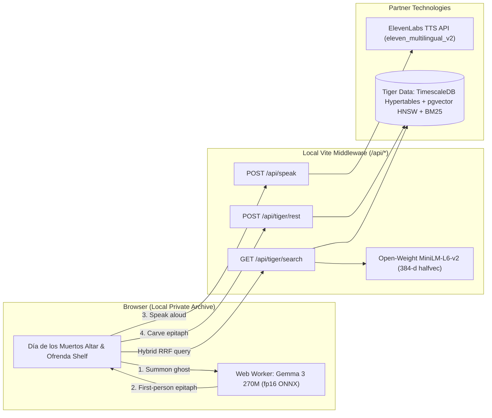

*This is a submission for the [Hacktoberfest Open-Source AI Challenge: Week 4](https://dev.to/challenges/hacktoberfest-week4-2026-10-26).*


## What I Built: Ghosts of the Feed 🕯️🌼

Every developer's bookmark folder is a quiet graveyard of good intentions. Over the last eight years, I bookmarked **1,832 posts** on X/Twitter — clever Unity water shaders from 2019, procedural foliage breakdowns, weekend game-jam physics toys, and open-weight model releases — telling myself *"I'll build something with this on Saturday."* Almost none of them were ever opened again.

For **Week 4 ("Ghost in the Machine")** — which falls right as Halloween meets **Día de los Muertos** — I built **Ghosts of the Feed**: an interactive digital *ofrenda* (altar) that honors those forgotten ideas and lets them speak back.

Instead of a cold productivity dashboard, **Ghosts of the Feed** treats every saved post as a spirit waiting in the dark:

- **Candlelit Ofrenda Shelf**: Each bookmark is placed on a velvet altar card with a flickering votive flame, a badge showing how long it has waited (some for **8 years**), and a pulsing marigold whisper (*"Unheard since you bookmarked me — Light candle & listen →"*).
- **In-Browser Séance with Google Gemma 3 270M**: When you bring a card to the altar and press **Summon this ghost**, `onnx-community/gemma-3-270m-it-ONNX` runs 100% locally inside a browser Web Worker via `@huggingface/transformers`. Speaking in the first person *as that forgotten post*, Gemma remembers what it was when you saved it and proposes one concrete thing you can still build with it today.
- **Spectral Voice via ElevenLabs**: As soon as Gemma finishes writing the ghost's response, **ElevenLabs** (`eleven_multilingual_v2`) speaks the epitaph aloud while the altar candle flares in sync (with a zero-config Web Speech fallback for judges testing without an API key).
- **Eternal Memory & Hybrid Search via Tiger Data**: Powered by **Tiger Cloud (`TimescaleDB` + `pgvector` + `pg_textsearch`)**, the app tracks your bookmark history in time-partitioned hypertables, fuses semantic vector search (`halfvec(384)`) with BM25 keyword search via **Reciprocal Rank Fusion (RRF)**, and permanently carves each summoned ghost's epitaph into stone so answered spirits turn jade on the shelf (**Put to Rest**).

---

## Demo & Repository 🔗

- **GitHub Repository (MIT Licensed)**: [https://github.com/eduardconstantin/ghosts-of-the-feed](https://github.com/eduardconstantin/ghosts-of-the-feed)

### App Walkthrough Screenshots

#### 1. The Candlelit Altar Shrine (`Gemma 3 270M` in-browser ONNX + `ElevenLabs` voice)


#### 2. The Ofrenda Shelf & Timeline of the Unanswered (`TimescaleDB` Continuous Aggregate + `seance_rituals` Hypertable)


#### 3. Hybrid Semantic + Keyword Search (`pgvector` HNSW Cosine + `pg_textsearch` BM25 via Reciprocal Rank Fusion)


### How Judges Can Test in 60 Seconds (No Login or API Keys Required)

```bash
git clone https://github.com/eduardconstantin/ghosts-of-the-feed.git
cd ghosts-of-the-feed
npm install
npm run dev
```

1. Open `http://localhost:5173`. The repo ships with `public/bookmarks-demo.json` and a pre-seeded Tiger Data snapshot (`src/tiger-cache.json`) so the timeline, hybrid RRF search, and séance work out of the box with zero credentials.
2. Click any offering card on the shelf (or filter by year in the **Timeline of the Unanswered (2018 – 2026)** bar chart).
3. Click **✦ Summon this ghost** at the altar. On the first summon, `Gemma 3 270M` (`fp16` ONNX) downloads into your browser cache and generates the ghost's first-person reply on your machine.
4. Type a mood or concept into the search bar — e.g. `abandoned shader water unity` — to see **Tiger Data Reciprocal Rank Fusion** rank ghosts by combined `pgvector` HNSW cosine similarity (`VEC #1`) and `pg_textsearch` BM25 rank (`BM25 #2`).
5. *(Optional)* Add `ELEVENLABS_API_KEY` and `TIGER_DATABASE_URL` in `.env` (see `.env.example`) to enable live ElevenLabs neural speech and live Tiger Cloud writes.

---

## How to Export Your Own X Bookmarks (`bird` CLI + Agent Skill) 🐦📦

Getting your own bookmarks out of X/Twitter without paying for an enterprise API tier was the first hurdle we solved. We used the open-source [`x-bookmarks`](https://github.com/sharbelxyz/x-bookmarks) agent skill together with [`@steipete/bird`](https://www.npmjs.com/package/@steipete/bird) — a fast GraphQL CLI for X that authenticates using your existing local browser session.

### 1. Install the real `bird` CLI (watch out for the npm name collision!)
Many READMEs say `npm i -g bird-cli`, which actually installs an unrelated scaffolding package on npm. The real X/Twitter CLI is **`@steipete/bird`**:

```bash
# Install the actual X/Twitter CLI
npm install -g @steipete/bird@0.8.0

# Optional: install the x-bookmarks skill for your coding agent
npx -y skills add sharbelxyz/x-bookmarks -g -y
```

### 2. Close your browser & verify your session (`bird whoami`)
Chromium-based browsers (Chrome, Brave, Edge, Opera) lock their SQLite `Network/Cookies` database while running, and cookie expiration timestamps (`expires_utc`) in modern Chromium profiles exceed 53-bit JavaScript numbers (`13471969281000000`), which requires **Node 24+** (`node:sqlite` with `readBigInts: true`).

Close your browser completely so the SQLite lock is released, then run:

```bash
# Chrome / Brave default profile:
bird --cookie-source chrome --chrome-profile "Default" whoami

# Opera / custom Chromium profile directory:
bird --cookie-source chrome --chrome-profile-dir "/path/to/Opera Stable/Default" whoami
```

### 3. Export all bookmarks to JSON (`--all --json`)
Once `bird whoami` prints your handle, paginate through your entire bookmark history and write it to `public/bookmarks.json` (which is gitignored so your personal archive is never committed):

```bash
bird --plain \
  --cookie-source chrome \
  --chrome-profile "Default" \
  bookmarks --all --json > public/bookmarks.json
```

> **Alternative (X API v2 OAuth 2.0 PKCE)**: If you prefer not to use browser cookies, the `x-bookmarks` skill also includes `scripts/x_api_auth.py` and `scripts/fetch_bookmarks_api.py`, which output the exact same `{ "tweets": [...] }` JSON schema. You can also upload any export file directly in the app via the **Load another export** button on the shelf.

---

## System Architecture



---

## Why Open Innovation Matters Here 🔓

Our social-media bookmarks are an intimate map of our curiosity — years of late-night rabbit holes, half-formed side projects, and personal tastes.

1. **Your personal archive stays on your machine**: By running **Gemma 3 270M** (`onnx-community/gemma-3-270m-it-ONNX`) directly inside a browser Web Worker and embedding queries locally with open-weight **MiniLM-L6-v2** (`Xenova/all-MiniLM-L6-v2`), you don't have to upload your entire private bookmark export to a proprietary LLM API just to reflect on what you saved.
2. **Works after platforms and APIs change**: Twitter/X has repeatedly locked down its API pricing and endpoints. Paired with open-source export tooling (`@steipete/bird`) and open-weight ONNX models cached in the browser, your ofrenda keeps working even when the lights (or the internet) go out.
3. **Inspectable & hackable**: While wiring up `gemma-3-270m-it-ONNX` in the browser, we hit an ONNX Runtime Web failure on the 4-bit graph (`ERROR_CODE: 9 — Could not find an implementation for GatherBlockQuantized(1) node with name '/model/embed_tokens/Gather_Quant'`). Because the weights, config, and ONNX graphs are open on Hugging Face, we could inspect the operator nodes across `model_q4.onnx`, `model_quantized.onnx`, and `model_fp16.onnx`, verify that `fp16` avoids `GatherBlockQuantized`, and switch the worker cleanly:

```javascript
// src/seance.worker.js
import { pipeline, env } from "@huggingface/transformers";

env.allowLocalModels = false;
const MODEL = "onnx-community/gemma-3-270m-it-ONNX";

let generator = await pipeline("text-generation", MODEL, {
  dtype: "fp16", // Avoids GatherBlockQuantized op unsupported in WASM runtime
  progress_callback: (update) => self.postMessage({ type: "progress", update }),
});
```

One detail we also had to solve: our Windows terminal export of `x-bookmarks.json` had UTF-8 curly quotes and emojis mangled through Code Page 437 (`What’s` became `WhatΓÇÖs`). Writing a 30-line CP437-to-UTF-8 byte decoder (`src/repair.js`) restored all 1,832 bookmarks cleanly before embedding them.

---

## Partner Technologies Used 🏆

### 1. Best Use of Gemma (`google/gemma-3-270m-it`)
- Runs `onnx-community/gemma-3-270m-it-ONNX` inside `src/seance.worker.js` so token generation never blocks the candle animations or UI thread.
- Uses a focused system prompt that turns Gemma into a first-person medium for the selected bookmark — stating what the post was when it was saved and one concrete action the author can take today.

### 2. Best Use of ElevenLabs (`eleven_multilingual_v2`)
- Proxied through our local Vite middleware (`POST /api/speak` in `vite.config.js`) so `ELEVENLABS_API_KEY` stays in `.env` and is never exposed in client-side bundles.
- Tuned voice settings (`stability: 0.3, similarity_boost: 0.8, style: 0.45, speed: 0.88`) give each summoned bookmark a warm, unhurried cadence while `.niche.is-speaking` accelerates the candle flame animation.

### 3. Best Use of Tiger Data (`TimescaleDB` + `pgvector` + `pg_textsearch`)
We used three distinct **Tiger Cloud** capabilities together:

- **Time-Series Hypertables & Continuous Aggregates**:
  - `ghost_bookmarks` hypertable partitioned on `spoken_at` with `tsdb.enable_columnstore = true` and `segmentby = 'username'`.
  - `ghost_bookmarks_yearly` continuous aggregate using `time_bucket(INTERVAL '1 year', spoken_at)` with real-time aggregation (`timescaledb.materialized_only = false`) to render the interactive 2018–2026 bar chart.
  - `seance_rituals` hypertable partitioned on `summoned_at` to log every summoning ritual.
- **Hybrid Semantic + Keyword Search (`pgvector` HNSW + `pg_textsearch` BM25 + RRF)**:
  - All 1,832 bookmarks are embedded into 384-dimensional vectors (`halfvec(384)`) indexed with HNSW (`halfvec_cosine_ops`) alongside a `pg_textsearch` BM25 index (`USING bm25 (content) WITH (text_config = 'english')`).
  - A custom SQL function fuses both rankings in a single round-trip using **Reciprocal Rank Fusion**:

```sql
CREATE OR REPLACE FUNCTION rrf_search_ghosts(
  query_text TEXT,
  query_vec halfvec(384),
  match_limit INT DEFAULT 36
)
RETURNS TABLE (
  tweet_id TEXT,
  rrf_score DOUBLE PRECISION,
  semantic_rank BIGINT,
  bm25_rank BIGINT
)
LANGUAGE sql STABLE AS $$
  WITH semantic AS (
    SELECT g.tweet_id, ROW_NUMBER() OVER (ORDER BY g.embedding <=> query_vec) AS s_rank
    FROM ghost_souls g
    WHERE g.embedding IS NOT NULL
    ORDER BY g.embedding <=> query_vec
    LIMIT 60
  ),
  keyword AS (
    SELECT g.tweet_id, ROW_NUMBER() OVER (ORDER BY g.content <@> to_bm25query(query_text, 'ghost_souls_bm25_idx')) AS k_rank
    FROM ghost_souls g
    WHERE query_text IS NOT NULL AND btrim(query_text) <> ''
    ORDER BY g.content <@> to_bm25query(query_text, 'ghost_souls_bm25_idx')
    LIMIT 60
  )
  SELECT
    COALESCE(s.tweet_id, k.tweet_id) AS tweet_id,
    (COALESCE(2.0 / (60 + s.s_rank), 0.0) + COALESCE(1.0 / (60 + k.k_rank), 0.0))::DOUBLE PRECISION AS rrf_score,
    s.s_rank AS semantic_rank,
    k.k_rank AS bm25_rank
  FROM semantic s
  FULL OUTER JOIN keyword k ON s.tweet_id = k.tweet_id
  ORDER BY rrf_score DESC
  LIMIT match_limit;
$$;
```

---

*Built with open weights, candlelit CSS, and eight years of bookmarks finally brought back to life.*
