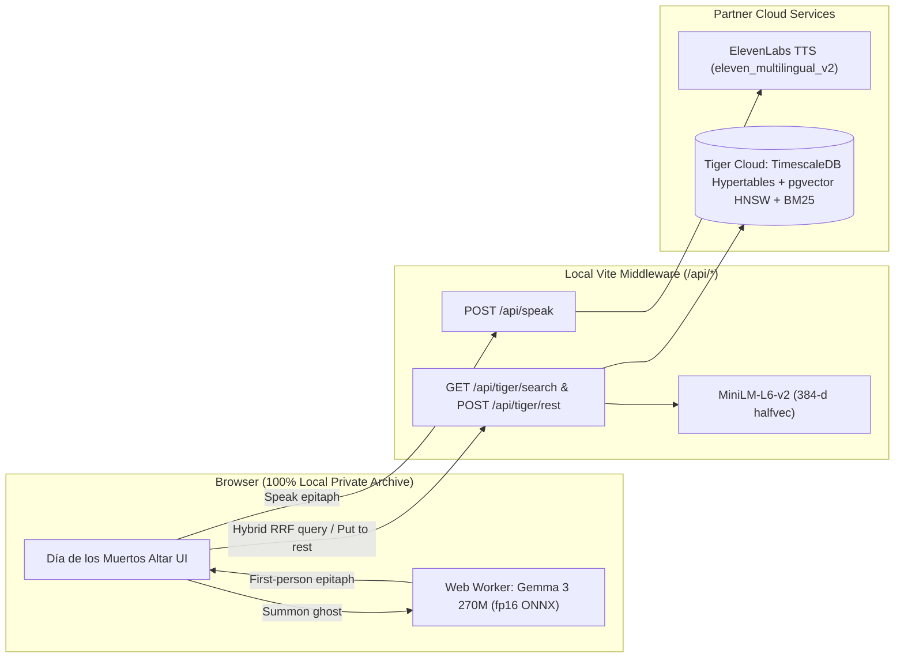

# Ghosts of the Feed

**An interactive Día de los Muertos ofrenda for forgotten X/Twitter bookmarks — powered by in-browser open-weight AI (`Gemma 3 270M`), `ElevenLabs` neural voice, and `Tiger Data` (`TimescaleDB` + `pgvector` + `pg_textsearch` BM25).**

Built for the **[Hacktoberfest 2026 Open-Source AI Challenge: Week 4 ("Ghost in the Machine")](https://dev.to/challenges/hacktoberfest-week4-2026-10-26)**.

---

## Why We Built It

Every developer's X bookmarks folder is a graveyard of good intentions — shaders we meant to study, papers we swore we'd read, weekend game-jam mechanics from seven years ago that we saved and never opened again.

In the spirit of **Día de los Muertos** and **Ghost in the Machine**, **Ghosts of the Feed** turns your bookmark archive into a candlelit altar (*ofrenda*). Each saved post becomes a spirit waiting in the dark:

1. **Google Gemma 3 270M (`onnx-community/gemma-3-270m-it-ONNX`)** runs 100% locally inside a browser Web Worker via `@huggingface/transformers` and ONNX Runtime Web (`fp16`), speaking in the first person as that forgotten post — remembering what it was when you saved it and proposing one concrete thing you can build with it today.
2. **ElevenLabs (`eleven_multilingual_v2`)** gives the summoned spirit a spoken voice right at the altar, while the votive candle flickers in sync.
3. **Tiger Data (`TimescaleDB` + `pgvector` + `pg_textsearch`)** powers the graveyard's memory:
   - **`ghost_bookmarks` & `seance_rituals` hypertables** with columnstore compression and a real-time continuous aggregate (`time_bucket('1 year', spoken_at)`) that drives the interactive **Timeline of the Unanswered (2018 – 2026)**.
   - **Hybrid Reciprocal Rank Fusion (RRF) search** combining `pgvector` HNSW cosine similarity (`halfvec(384)` from `Xenova/all-MiniLM-L6-v2`) with `pg_textsearch` BM25 keyword ranking (`<@>`).
   - **Put to Rest persistence**, carving Gemma's generated epitaph onto the offering card so answered spirits turn jade on the shelf.

---

## Architecture



---

## Quick Start

```bash
git clone https://github.com/eduardconstantin/ghosts-of-the-feed.git
cd ghosts-of-the-feed
npm install
cp .env.example .env
npm run dev
```

Open **`http://localhost:5173`**.

- The repository ships with `public/bookmarks-demo.json` (36 sample bookmarks) so anyone or any judge can test immediately with zero setup.
- To load your own full X bookmark archive (e.g. exported with `@steipete/bird`), drop `bookmarks.json` into `public/bookmarks.json` (gitignored so your personal archive stays private) or click **Load another export** in the shelf bar.
- Optional environment variables in `.env`:
  - `ELEVENLABS_API_KEY` — enables neural speech via ElevenLabs (falls back to Web Speech synthesis when unset).
  - `TIGER_DATABASE_URL` — connects live to your Tiger Cloud `TimescaleDB` service (falls back to the bundled snapshot in `src/tiger-cache.json` when unset).

---

## Exporting Your Own X/Twitter Bookmarks

You can export your entire X bookmark history into `public/bookmarks.json` (gitignored) using [`@steipete/bird`](https://www.npmjs.com/package/@steipete/bird) (or the [`x-bookmarks`](https://github.com/sharbelxyz/x-bookmarks) agent skill):

1. **Install `@steipete/bird`** (note: use `@steipete/bird`, not the unrelated `bird-cli` package on npm) and run with **Node 24+** so `node:sqlite` supports 64-bit Chromium cookie timestamps (`readBigInts`):
   ```bash
   npm install -g @steipete/bird@0.8.0
   ```
2. **Close your browser** (so the SQLite `Network/Cookies` file is not locked) and verify your session:
   ```bash
   # Chrome:
   bird --cookie-source chrome --chrome-profile "Default" whoami

   # Opera / custom Chromium profile directory:
   bird --cookie-source chrome --chrome-profile-dir "/path/to/Opera Stable/Default" whoami
   ```
3. **Export all bookmarks to `public/bookmarks.json`**:
   ```bash
   bird --plain --cookie-source chrome --chrome-profile "Default" bookmarks --all --json > public/bookmarks.json
   ```
   Or pick any exported `.json` file directly in the UI using **Load another export**.

---

## License

MIT — see [LICENSE](./LICENSE).
